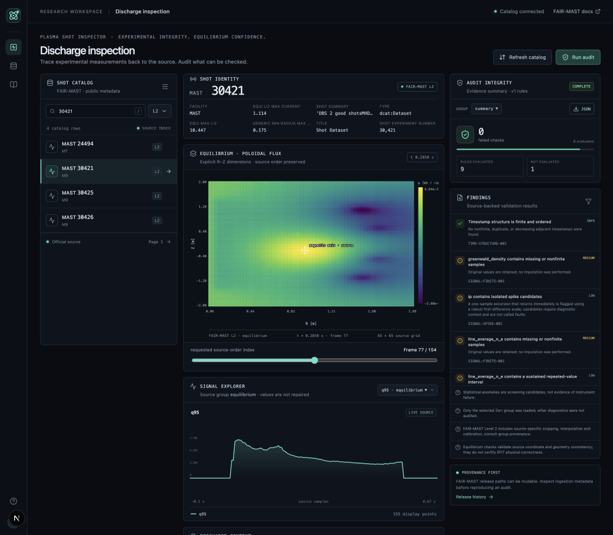
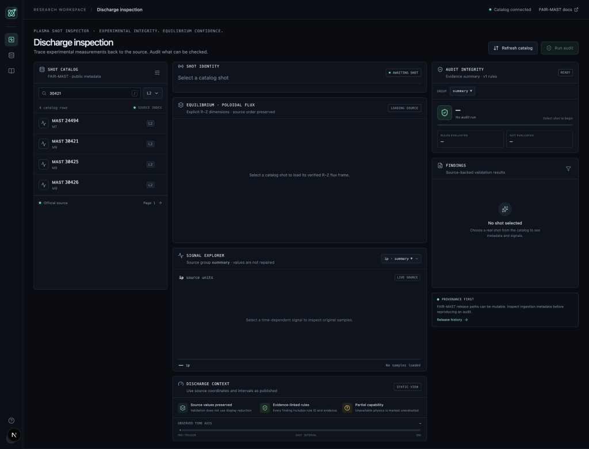
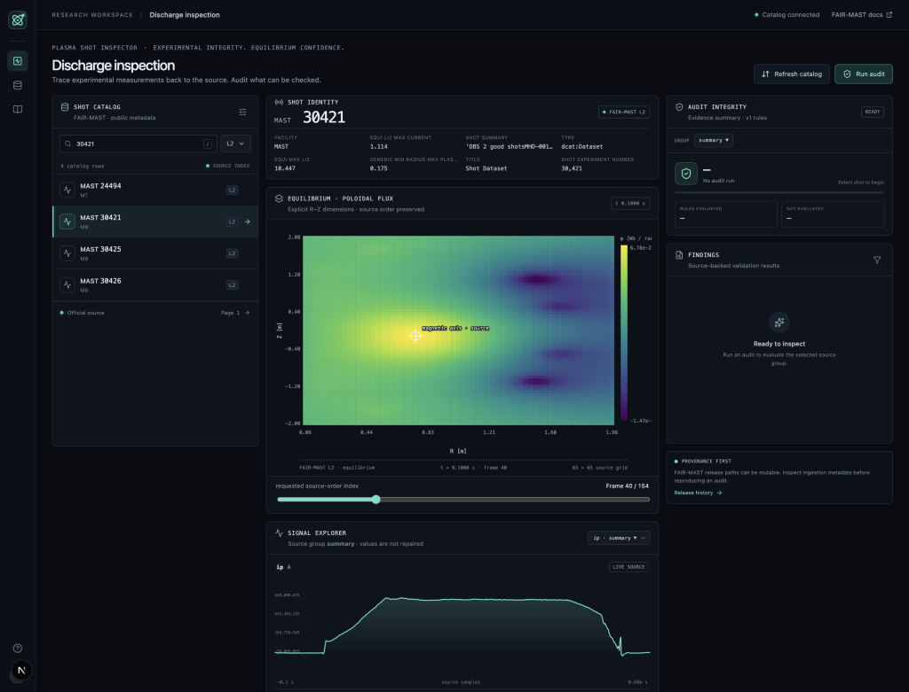
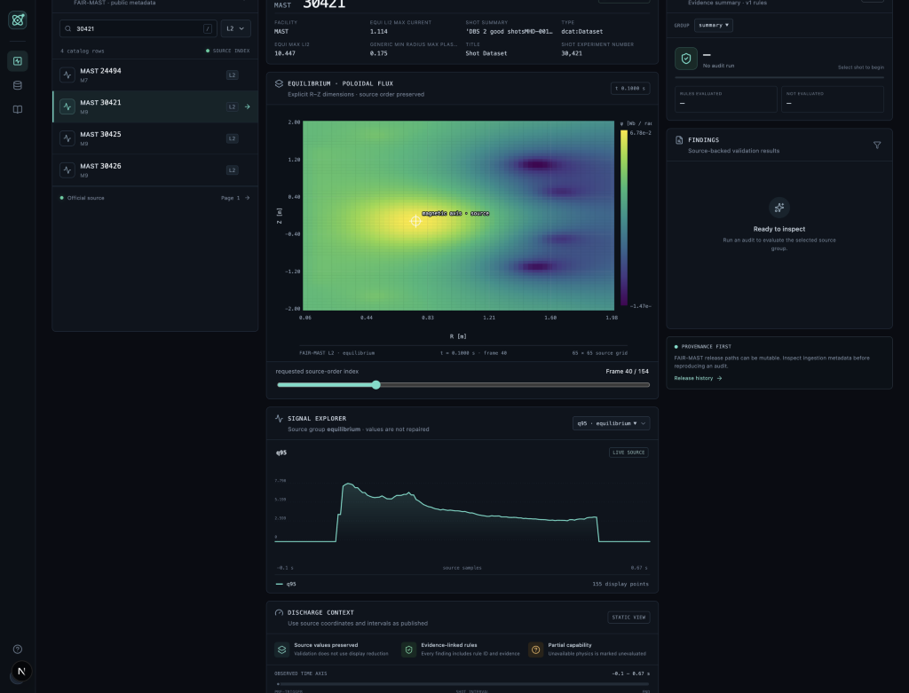
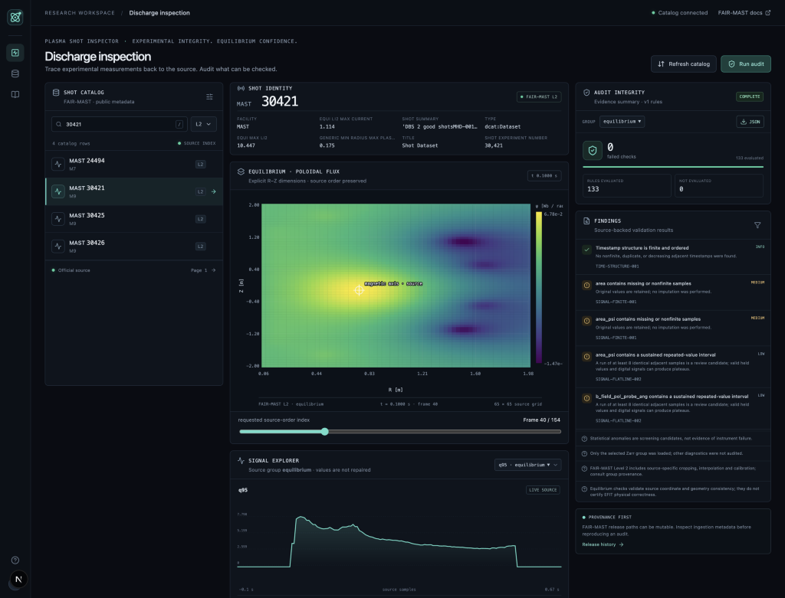
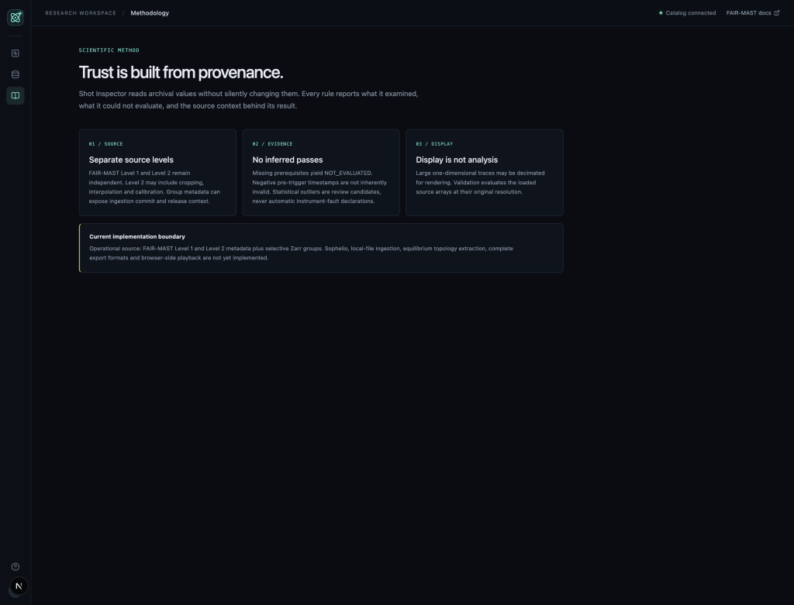

# Plasma Shot Inspector

**Experimental integrity. Equilibrium confidence.**

Plasma Shot Inspector is a research workstation for inspecting public FAIR-MAST shot data and running explainable structural checks. It reads source data without changing measurements and records provenance available from each source group.



_MAST shot 30421 (FAIR-MAST Level 2): equilibrium flux frame, signal explorer, and a completed `summary` audit with source-backed findings. Captured from a locally running instance against live FAIR-MAST data._

## Features

- Search FAIR-MAST Level 1 and Level 2 shot catalogs and inspect shot metadata.
- Browse signal and group metadata, and view one-dimensional signals and equilibrium flux frames.
- Check timestamps for empty, nonfinite, duplicate, decreasing, and unusually large-gap samples.
- Check signals for missing values, constant or repeated runs, and isolated spike candidates.
- Check supported equilibrium grids, coordinates, finite-cell coverage, source magnetic-axis and LCFS bounds, polygon validity, and available geometry consistency.
- Export a structured JSON audit report from the command line.

Findings are rule outcomes for review, not a universal score or certification of scientific suitability. A missing prerequisite is reported as not evaluated. The tool does not repair, interpolate, or impute source measurements.

## Screenshots

All screenshots were captured from a locally running instance using live FAIR-MAST Level 2 data (MAST shot 30421).

### Catalog search



Level 2 catalog search for `30421`.

### Equilibrium flux



Poloidal flux frame 40/154 with the source magnetic axis, alongside the plasma current (`ip`) trace.

### Signal explorer



`q95` plotted from source samples.

### Equilibrium audit



Equilibrium-group audit: 133 rules evaluated, with source-backed findings.

### Methodology



How provenance and not-evaluated results are handled.

## Scope

FAIR-MAST Level 1 and Level 2 are the supported data sources. The current release does not derive magnetic-axis positions, extract an LCFS from flux, classify X-points or topology, compare geometry between sources, provide synchronized playback, or support Sophelio, local-file, or batch adapters. Unsupported inputs and checks are reported as unavailable or not evaluated.

The API stores audit job metadata and reports in a local SQLite database. Raw archive measurements are not copied into that database. The API's background audit queue is in-process and is intended for local evaluation, not durable multi-worker deployments.

## Requirements

- Python 3.11 or newer
- Node.js 22 or newer
- pnpm 10
- Network access to install dependencies and query FAIR-MAST

## Run locally

```bash
make setup
make dev
```

The web interface is available at <http://localhost:3000>. The API listens at <http://127.0.0.1:8000>; its interactive documentation is at <http://127.0.0.1:8000/docs>. The API binds to loopback by default. Catalog metadata and data groups are fetched selectively; the archive is not downloaded in full.

## Command line

```bash
plasma-inspector catalog search --level 2 --limit 20
plasma-inspector catalog search --level 2 --q 30421
plasma-inspector shot inspect 30421 --level 2
plasma-inspector audit run 30421 --level 2 --group summary --output data/reports/30421.json
plasma-inspector rules list
plasma-inspector serve
```

The Python audit engine can also be used without the web interface or API:

```python
from plasma_inspector.audit import audit_shot

report = audit_shot(30421, level=2, group="summary")
print(report.model_dump_json(indent=2))
```

## Data and provenance

FAIR-MAST publishes shot catalogs and source data separately. Level 2 data is processed; consult the upstream documentation for its processing and mappings. Source group metadata can include an ingestion timestamp, commit URL, and license information. These values may differ between releases, and a URL alone does not identify an immutable data revision.

Timestamp order is preserved, and negative time values are not rejected solely because they may represent pre-trigger samples. Missing-value, flatline, and spike findings are candidates for review, not proof that a diagnostic is faulty. Plots may use display-only sampling; audits inspect the loaded source arrays at their available resolution.

For data definitions and release details, see the [FAIR-MAST quickstart](https://ukaea.github.io/fair-mast/quickstart.html), [Level 1 documentation](https://ukaea.github.io/fair-mast/level1-data.html), [Level 2 documentation](https://ukaea.github.io/fair-mast/level2-data.html), and [Level 2 release history](https://ukaea.github.io/fair-mast/level2/release-history.html).

The MIT license in this repository covers this project's code. FAIR-MAST data and its metadata retain the terms stated by FAIR-MAST and, where applicable, by individual source groups. Follow those terms and cite UKAEA/FAIR-MAST and the specific source release used in research outputs.

## Development

```bash
make setup
make test
make lint
make typecheck
make build
```

See [CONTRIBUTING.md](CONTRIBUTING.md) for the development workflow. Local databases, generated reports, and other files under `data/` are excluded from version control.

## License & Custom Work

[](mailto:work@withrana.com) [](https://www.linkedin.com/in/workwithrana)
[](https://www.upwork.com/freelancers/~01bbcf6edb91a8df5f)
[](https://contra.com/ranajahanzaib/)

**License:** MIT, see [LICENSE](LICENSE). Free for personal and commercial use.

**Author:** Rana Jahanzaib

**Need this built for your stack?** Email me what you're working on: work@withrana.com
